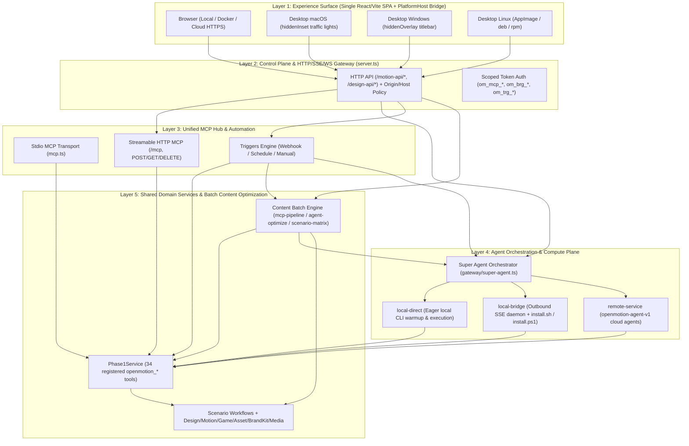

# Cross-Platform MCP-First Architecture

> Interactive diagram: [Visual Architecture & System Boundaries Diagram (HTML)](architecture-map.html)

OpenMotion is built around a unified **MCP-first, five-layer architecture** so the same creative workspace, tools, Skills, and batch content optimization pipelines operate consistently across:

- **Web & Cloud deployments** (browsers connected to local, Docker, or hosted HTTPS instances)
- **Desktop applications** (macOS, Windows, and Linux Electron clients wrapping a local Node sidecar)
- **External Agents** (local stdio MCP clients such as Codex, Claude Code, Cursor, and DeepSeek Harness, plus remote/cloud MCP clients over Streamable HTTP `/mcp`)
- **Automated Triggers** (webhooks, interval schedules, and manual/API invocations)

---

## Core Call Chains

### 1. Internal Web & Desktop App -> Agent -> MCP -> Domain Services

1. **Unified Studio SPA (`studio/`)** renders inside Chrome/Safari/Edge on the web or inside Electron `BrowserWindow` on macOS, Windows, and Linux.
2. **`PlatformHost` (`shared/platform-host.ts` & `studio/src/utils/platformHost.ts`)** detects `window.openmotionDesktop`. On web, controls gracefully fall back to browser downloads and web links; on desktop, native window chrome insets, theme synchronization, auto-updates, log export, and menu commands bridge cleanly over IPC.
3. **Super Agent (`gateway/super-agent.ts`)** routes turns through the selected execution runtime in `gateway/agent-runtimes.ts`:
   - **`local-direct`** (local & desktop): eager warmup on startup (`LocalAgentDirectory.warmup()`) discovers installed local Agent CLIs (Codex, Claude Code, OpenCode, Cursor, Gemini CLI, etc.) and injects the live MCP tool connection (`local stdio` or loopback `http://127.0.0.1:<port>/mcp`).
   - **`local-bridge`** (web/cloud -> user workstation): user runs `install.sh` (macOS/Linux) or `install.ps1` (Windows) or connects from desktop. The bridge daemon keeps an outbound-only SSE connection to `/motion-api/agent-runtimes/bridge/stream`, runs the user's local Agent CLI behind NAT/firewalls, and posts MCP tool calls back to `/motion-api/agent-runtimes/bridge/tool-call`.
   - **`remote-service`** (cloud -> cloud): connects external Agent services speaking the `openmotion-agent-v1` HTTP+SSE protocol, returning `tool.call` frames executed on OpenMotion's shared domain tools.

### 2. External Agents -> Unified MCP Hub -> Domain Services

Both external transports converge on the exact same `mcpRegistry('phase1')` definitions, `Phase1Service` tool execution, `workflowResources()`, and `validateInput()` guards:

- **Local Stdio MCP (`mcp.ts`)**: Used by desktop Agent hosts (Codex, Claude Code, Cursor, DeepSeek Harness) and Docker `docker exec`.
- **Streamable HTTP MCP (`POST / GET / DELETE /mcp`, `gateway/mcp-http.ts`)**:
  - Supports protocol revisions `2024-11-05`, `2025-03-26`, `2025-06-18`, and `2025-11-25`.
  - Uses `Mcp-Session-Id` headers, optional `Accept: text/event-stream` SSE framing on `POST`, server-push notifications on `GET /mcp`, and explicit session termination on `DELETE /mcp`.
  - Authenticated via SHA-256 hashed scoped Bearer tokens (`om_mcp_...`) managed in **Settings -> Local Agents -> Runtimes & Cloud Bridge** or `/motion-api/mcp/tokens` (`read` | `write` | `admin` scopes). In `cloud` mode or when `MOTION_MCP_REQUIRE_AUTH=1`, Bearer authentication is strictly mandatory.

### 3. Batch Content Optimization & Triggers

Batch content optimization exposes one shared capability (`gateway/content-batch.ts`, `shared/content-batch.ts`) across **REST API** (`/motion-api/content-batches`), **MCP** (`openmotion_assets_use` with `action="batch"`), **Super Agent**, and **Triggers** (`openmotion_assets_use` with `action="trigger"`):

- **`mcp-pipeline` mode**: Runs deterministic multi-step MCP tool pipelines across up to 50 items with bounded concurrency (`1..8`), template variable interpolation (`{{item.*}}`, `{{shared.*}}`, `{{steps.<id>.*}}`), per-item fault isolation, `retry_failed`, cancellation, and ZIP bundle export.
- **`agent-optimize` mode**: Dispatches each item through Super Agent (`local-direct`, `local-bridge`, or `remote-service`) with structured optimization rubrics so an AI Agent evaluates, edits, and produces artifacts in parallel.
- **`scenario-matrix` mode**: Executes full multi-step Scenario Workflows (`gateway/scenario-runs.ts`) across a matrix of products, audiences, or locales.
- **Triggers (`gateway/triggers.ts`)**: Fires an MCP tool, Content Batch, or Super Agent turn via authenticated incoming webhooks (`Bearer om_trg_...` or HMAC `X-OpenMotion-Signature: sha256=...`), interval schedules (`>= 60s`), or manual runs.
- **Open Design Cloud Web Publishing (`gateway/web-publish.ts`, `gateway/web-publish-bundle.ts`, `gateway/web-publish-ops.ts`, `gateway/design-deploy.ts`)**: Reuses the shared Open Design sign-in (`gateway/account.ts`) to automatically stage and bundle referenced local workspace media (`_shared-assets/`), track SHA-256 content `freshness`, and publish any HTML-expressed OpenMotion deliverable — **Design Studio** pages, **Game Studio** playable HTML games, **Motion** HTML bundles, or standalone `.html`/static folders — via one unified `WebPublishPopover` across Design Studio, Game Studio, and Super Agent's `ArtifactBrowserPane`, as well as `openmotion_assets_use(action="web_publish")`, `openmotion_design_project(action="deploy|deploy_status|unpublish")`, or `/motion-api/web-publish/:kind/:id`, minting stable HTTPS share URLs.

---

## Cross-Platform Desktop Architecture (`desktop/`)

OpenMotion's desktop wrapper lives in the standalone `desktop/` package so root `package.json` and headless npm/Docker distributions stay clean and free of Electron native binaries.

| OS | Window Titlebar & Safe Area | Window Controls | Packaging Targets |
| --- | --- | --- | --- |
| **macOS** | `titleBarStyle: 'hiddenInset'`, `trafficLightPosition: { x: 14, y: 15 }`, header left inset `78px` (collapses to `0px` in fullscreen) | Native macOS traffic lights | `.dmg` + `.zip` (`arm64`, `x64`) |
| **Windows** | `titleBarStyle: 'hidden'` + dynamic theme-synced `titleBarOverlay`, header right inset `138px` | Native Windows caption overlay | NSIS installer (`.exe`) + Portable (`x64`, `arm64`) |
| **Linux** | Frameless custom header (`insetRight: 132px`) or native window frame (`MOTION_LINUX_NATIVE_FRAME=1`) | Shared `IconButton` window controls (`Minimize`, `Maximize/Restore`, `Close`) | `AppImage`, `.deb`, `.rpm` (`x64`, `arm64`) |

### Desktop Lifecycle & Support Features

- **Branded Frameless Splash Screen (`desktop/src/splash.ts`, `desktop/src/splash.html`)**: Displays the OpenMotion mark and status while the local Node sidecar boots, with OS light/dark parity, reduced-motion support, and interactive **Retry** / **Export Logs** actions if startup fails.
- **Sidecar Supervision (`desktop/src/sidecar.ts`)**: Launches `server.ts` on a free `127.0.0.1` loopback port with isolated `<userData>/workspace` data storage and awaits `/api/health`, terminating cleanly on quit or before auto-update relaunch.
- **Structured Desktop Logs & Redacted Diagnostics (`desktop/src/logger.ts`, `scripts/diagnostics.mjs`)**: Writes bounded, secret-redacted `main.log`, `renderer.log`, `sidecar.log`, `gpu-info.json`, and crash detection markers (`session-state.json`) under `<userData>/logs/desktop/` and automatically bundles them into `logs/desktop/` when exporting diagnostic ZIPs.
- **Native Menus & Auto-Updater (`desktop/src/menu.ts`, `desktop/src/updater.ts`)**: Exposes **Check for Updates…** (`electron-updater` over GitHub Releases `stable`/`beta`), **Export Diagnostic Logs…**, **Report an Issue…**, and **Join Community** (Feishu Group / Discord).

---

## Deployment Modes & Unified Development

- **Web dev with HMR**: `npm run dev:web` starts `server.ts` + Vite dev server (`studio/vite.dev.config.ts`) with `/mcp`, `/motion-api`, and WS proxies.
- **Desktop dev with HMR**: `npm run dev:desktop` starts the same backend + Vite dev server and launches Electron against the live Vite URL so frontend edits reload immediately in Desktop.
- **Cloud / Self-Hosted Docker**: `docker compose -f deploy/docker-compose.cloud.yml up -d` runs OpenMotion in `MOTION_DEPLOYMENT_MODE=cloud` behind your TLS reverse proxy, exposing `/mcp` with mandatory Bearer token auth and accepting `local-bridge` workers from macOS, Windows, and Linux workstations.

---

## Reference Architecture Patterns & Acknowledgements

The cross-platform, runtime-bridge, and desktop architecture draws on proven engineering patterns from the following open-source projects:

- **[Multica](https://github.com/multica-ai/multica)**: Control-plane vs compute-plane separation and outbound-only local runtime bridge daemon enabling cloud workspaces to drive local CLI Agents safely without inbound firewall ports.
- **[LobeHub](https://github.com/lobehub/lobehub)**: Single React/Vite web and Electron desktop application sharing UI modules through a thin platform-capability abstraction, supporting both local stdio and remote Streamable HTTP MCP connections alongside channel-based updates.
- **[T3 Code](https://github.com/pingdotgg/t3code)**: Lightweight Electron shell managing a local Node backend, strict `contextBridge` preload APIs (`fullscreenchange` synchronization), OS-aware hidden titlebars/caption overlays, and multi-architecture macOS/Windows/Linux packaging.
- **[Open Design](https://github.com/nexu-io/open-design)**: Sidecar health handoff, frameless branded startup splash window, structured segmented desktop log files with crash-marker detection, native support menus, and safe updater handoff that closes child sidecars prior to relaunch.
- **[Paradev](https://github.com/paradevai/paradev)**: Multi-agent parallel orchestration and programmatic/MCP-accessible task automation across isolated creative workspaces.
